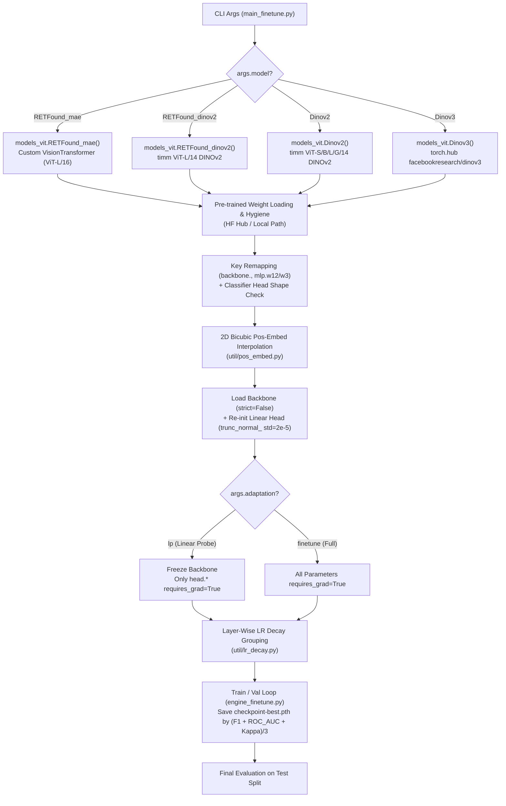

# RETFound Architecture & Fine-Tuning Analysis

This document details how Vision Transformer (ViT) architectures are constructed, initialized with pre-trained weights, and adapted for downstream retinal image classification in the RETFound codebase.

---

## 1. High-Level Architecture & Pipeline Overview

The codebase is organized around four core modules:
1. **[models_vit.py](../models_vit.py)**: Defines the custom [`VisionTransformer`](../models_vit.py#L11-L45) class and factory functions for four model families (`RETFound_mae`, `RETFound_dinov2`, `Dinov2`, `Dinov3`).
2. **[main_finetune.py](../main_finetune.py)**: Orchestrates model instantiation, checkpoint downloading/remapping, positional embedding interpolation, parameter freezing (`finetune` vs. `lp`), layer-wise learning rate decay, and the train/val/test lifecycle.
3. **[engine_finetune.py](../engine_finetune.py)**: Implements [`train_one_epoch`](../engine_finetune.py#L19-L82) (AMP mixed-precision, gradient accumulation, Mixup, cosine LR scheduling) and [`evaluate`](../engine_finetune.py#L84-L148) (multi-class classification metrics and confusion matrix export).
4. **[util/](../util)**: Provides 2D bicubic positional embedding interpolation ([pos_embed.py](../util/pos_embed.py)), BEiT-style layer-wise LR decay ([lr_decay.py](../util/lr_decay.py)), per-iteration warmup/cosine LR scheduling ([lr_sched.py](../util/lr_sched.py)), and dataset/augmentation builders ([datasets.py](../util/datasets.py)).



---

## 2. Model Architecture Construction ([models_vit.py](../models_vit.py))

In [`main()`](../main_finetune.py#L164-L177), the model is dynamically looked up via `models.__dict__[args.model](...)`:

| Model Key (`--model`) | Factory Function | Underlying Backbone | Patch Size | Embed Dim | Depth | Heads | Global Pool Support |
| :--- | :--- | :--- | :--- | :--- | :--- | :--- | :--- |
| `RETFound_mae` | [`RETFound_mae`](../models_vit.py#L47-L51) | Custom [`VisionTransformer`](../models_vit.py#L11-L45) subclassing `timm` | $16 \times 16$ | 1024 | 24 | 16 | Configurable via `--global_pool` / `--cls_token` |
| `RETFound_dinov2` | [`RETFound_dinov2`](../models_vit.py#L79-L86) | `timm`: `vit_large_patch14_dinov2.lvd142m` | $14 \times 14$ | 1024 | 24 | 16 | Uses `timm` default (`cls_token`) |
| `Dinov2` | [`Dinov2`](../models_vit.py#L55-L75) | `timm`: `vit_{small,base,large,giant}_patch14_dinov2.lvd142m` | $14 \times 14$ | 384 / 768 / 1024 / 1536 | 12 / 12 / 24 / 40 | 6 / 12 / 16 / 24 | Uses `timm` default (`cls_token`) |
| `Dinov3` | [`Dinov3`](../models_vit.py#L89-L105) | `torch.hub`: `facebookresearch/dinov3` (`args.model_arch`) | Depends on `model_arch` | `model.embed_dim` or `num_features` | Depends on `model_arch` | Depends on `model_arch` | Hub model default + custom `nn.Linear` head |

### 2.1 Custom `VisionTransformer` (`RETFound_mae`)
[`VisionTransformer`](../models_vit.py#L11-L45) subclasses `timm.models.vision_transformer.VisionTransformer` to add MAE-style **global average pooling over patch tokens**:

1. **`__init__` ([L14-L23](../models_vit.py#L14-L23))**:
   - When `global_pool=True` (the default in [`main_finetune.py`](../main_finetune.py#L55)), it creates a dedicated LayerNorm `self.fc_norm = norm_layer(embed_dim)` ($\epsilon = 10^{-6}$) and **deletes** the original `self.norm` layer (`del self.norm`) so unused parameters do not interfere with DDP.
2. **`forward_features(x)` ([L25-L44](../models_vit.py#L25-L44))**:
   - Converts input image $x \in \mathbb{R}^{B \times 3 \times H \times W}$ into patch tokens via `self.patch_embed(x)` of shape $(B, N, D)$, where $N = (H/16) \times (W/16)$ and $D = 1024$.
   - Prepends `self.cls_token` $\rightarrow (B, 1 + N, D)$, adds `self.pos_embed`, applies `self.pos_drop`, and passes tokens sequentially through all 24 Transformer `self.blocks`.
   - **Pooling branch**:
     - If `self.global_pool=True`: discards the `[CLS]` token at index `0`, averages across all spatial patch tokens `x[:, 1:, :].mean(dim=1, keepdim=True)` $\rightarrow (B, 1, D)$, and normalizes via `self.fc_norm(x)`.
     - If `self.global_pool=False` (`--cls_token`): applies `self.norm(x)` to the full sequence and extracts `x[:, 0]` $\rightarrow (B, D)$.
   - Inherited `timm` `forward_head` / `forward` then passes the resulting representation through `self.head` (`nn.Linear(1024, num_classes)`).

> [!WARNING]
> **Tensor Shape Nuance in `VisionTransformer.forward_features`**:
> When `global_pool=True`, `x = x[:, 1:, :].mean(dim=1, keepdim=True)` produces shape `(B, 1, 1024)` instead of `(B, 1024)`. In older `timm` versions (`timm==0.3.2` specified in [requirements.txt](../requirements.txt#L2)), `self.head(x)` outputs `(B, 1, num_classes)` unless squeezed or handled by `forward_head`. Notice that in [latent_feature.ipynb](../latent_feature.ipynb#L66), `torch.squeeze(latent)` is explicitly called on the output of `forward_features`.

### 2.2 DINOv2 & RETFound_dinov2 Models
Both [`Dinov2`](../models_vit.py#L55-L75) and [`RETFound_dinov2`](../models_vit.py#L79-L86) call `timm.create_model(..., pretrained=True, img_size=224, **kwargs)` where `kwargs` from [`main_finetune.py`](../main_finetune.py#L173-L177) supplies `num_classes=args.nb_classes` and `drop_path_rate=args.drop_path`.

> [!IMPORTANT]
> **Hardcoded `img_size=224` in `Dinov2` / `RETFound_dinov2`**:
> Unlike `RETFound_mae` (which receives `img_size=args.input_size`), [`Dinov2`](../models_vit.py#L72) and [`RETFound_dinov2`](../models_vit.py#L83) hardcode `img_size=224`. While [`get_args_parser()`](../main_finetune.py#L53) defaults `--input_size` to `256`, [train.sh](../train.sh#L26) explicitly passes `--input_size 224` so the dataset transforms match the `timm` model's `patch_embed` grid assertions.

### 2.3 DINOv3 Model
[`Dinov3`](../models_vit.py#L89-L105) loads the architecture from `facebookresearch/dinov3` via `torch.hub.load(..., pretrained=False)` (where `model.head` is `nn.Identity` by default), inspects `model.embed_dim` or `model.num_features`, attaches a new `nn.Linear(feat_dim, args.nb_classes)` classification head, and initializes it with `trunc_normal_(std=2e-5)` and zero bias.

---

## 3. Pre-Trained Checkpoint Loading & Weight Hygiene

When `--finetune` is provided (and `--eval` is not set), [`main()`](../main_finetune.py#L180-L228) executes a 6-step weight adaptation pipeline:

### Step 1: Checkpoint Resolution ([L183-L198](../main_finetune.py#L183-L198))
- **`RETFound_mae` / `RETFound_dinov2`**: Automatically downloads weights from Hugging Face Hub at `YukunZhou/{args.finetune}/{args.finetune}.pth` (e.g., `YukunZhou/RETFound_dinov2_meh`).
- **`Dinov2` / `Dinov3`**: Treats `args.finetune` as a local filesystem path.

### Step 2: State-Dict Extraction ([L200-L206](../main_finetune.py#L200-L206))
Different pre-training frameworks nest their weights under different top-level dictionary keys:
- `RETFound_mae`: `checkpoint["model"]`
- `RETFound_dinov2`: `checkpoint["teacher"]` (DINOv2 EMA teacher weights)
- `Dinov2` / `Dinov3`: `checkpoint` directly

### Step 3: Key Hygiene & Remapping ([L207-L210](../main_finetune.py#L207-L210))
DINOv2 teacher checkpoints prefix backbone parameters with `backbone.` and optionally use fused SwiGLU naming (`w12`, `w3`). These are normalized to match `timm` conventions:
```python
checkpoint_model = {k.replace("backbone.", ""): v for k, v in checkpoint_model.items()}
checkpoint_model = {k.replace("mlp.w12.", "mlp.fc1."): v for k, v in checkpoint_model.items()}
checkpoint_model = {k.replace("mlp.w3.", "mlp.fc2."): v for k, v in checkpoint_model.items()}
```

### Step 4: Classifier Head Pruning ([L212-L217](../main_finetune.py#L212-L217))
If `head.weight` or `head.bias` exists in `checkpoint_model` with a shape different from the newly constructed model's `state_dict()`, those keys are deleted prior to loading.

### Step 5: 2D Bicubic Positional Embedding Interpolation ([util/pos_embed.py](../util/pos_embed.py#L71-L92))
[`interpolate_pos_embed(model, checkpoint_model)`](../util/pos_embed.py#L71-L92) enables fine-tuning at image resolutions different from pre-training:
1. Computes `num_patches = model.patch_embed.num_patches` and `num_extra_tokens = model.pos_embed.shape[-2] - num_patches` (e.g., `1` for `[CLS]`).
2. Computes the checkpoint grid size $\text{orig\_size} = \sqrt{N_{\text{ckpt}} - N_{\text{extra}}}$ and target grid size $\text{new\_size} = \sqrt{N_{\text{target}}}$.
3. Splits `pos_embed_checkpoint` into `extra_tokens` (kept unchanged) and spatial `pos_tokens`.
4. Reshapes `pos_tokens` to $(1, D, \text{orig\_size}, \text{orig\_size})$, applies 2D bicubic interpolation (`F.interpolate(..., mode='bicubic', align_corners=False)`) to $(\text{new\_size}, \text{new\_size})$, flattens back to $(1, \text{new\_size}^2, D)$, and concatenates with `extra_tokens`.

### Step 6: Non-Strict Load & Classifier Head Re-initialization ([L222-L228](../main_finetune.py#L222-L228))
- Calls `model.load_state_dict(checkpoint_model, strict=False)` so missing keys (such as `fc_norm` or `head`) do not raise errors.
- Re-initializes `model.head.weight` using `trunc_normal_(model.head.weight, std=2e-5)`.

---

## 4. Fine-Tuning vs. Linear Probing & Optimization Mechanics

### 4.1 Adaptation Modes (`--adaptation`)
Configured in [`main()`](../main_finetune.py#L308-L315):
- **`finetune` (Full Fine-Tuning, default)**: All backbone and head parameters remain trainable (`requires_grad = True`).
- **`lp` (Linear Probing)**: Freezes the backbone by setting `param.requires_grad = ("head" in name)`. When running under multi-GPU `DistributedDataParallel`, `find_unused_parameters=True` is automatically enabled ([L332-L333](../main_finetune.py#L332-L333)).

### 4.2 Effective Batch Size & Linear LR Scaling Rule
In [`main()`](../main_finetune.py#L320-L327), if `--lr` is not explicitly set, the actual learning rate is scaled linearly from the base learning rate (`--blr`, default `5e-3`):
$$\text{eff\_batch\_size} = \text{batch\_size} \times \text{accum\_iter} \times \text{world\_size}$$
$$\text{lr} = \text{blr} \times \frac{\text{eff\_batch\_size}}{256}$$

### 4.3 Layer-Wise Learning Rate Decay ([util/lr_decay.py](../util/lr_decay.py))
To preserve low-level pre-trained visual features while allowing deeper layers and the classification head to adapt more rapidly, [`param_groups_lrd()`](../util/lr_decay.py#L9-L59) assigns each parameter a `layer_id` in $[0, N_{\text{layers}}]$ where $N_{\text{layers}} = \text{len}(\text{model.blocks}) + 1$ (i.e., $24 + 1 = 25$ for ViT-Large):

| Parameter Name Pattern | Assigned `layer_id` | LR Scale Factor (`layer_decay` = $\gamma$, default $0.65$) | Weight Decay |
| :--- | :--- | :--- | :--- |
| `cls_token`, `pos_embed`, `patch_embed.*` | `0` | $\gamma^{25 - 0} = \gamma^{25}$ (smallest LR) | `0.0` for 1D / `no_weight_decay_list`; `0.05` otherwise |
| `blocks.{i}.*` ($i \in [0, 23]$) | `i + 1` ($1 \dots 24$) | $\gamma^{25 - (i + 1)}$ | `0.0` for 1D (biases, LayerNorm); `0.05` for 2D weights |
| `fc_norm.*`, `norm.*`, `head.*` | `num_layers` (`25`) | $\gamma^{25 - 25} = 1.0$ (full LR) | `0.0` for 1D (`bias`, norm); `0.05` for `head.weight` |

> [!NOTE]
> **Per-Iteration Cosine Schedule ([util/lr_sched.py](../util/lr_sched.py#L8-L20))**:
> At the start of every accumulation step in [`train_one_epoch()`](../engine_finetune.py#L43-L44), [`adjust_learning_rate()`](../util/lr_sched.py#L8-L20) computes the global fractional epoch $e = \text{epoch} + \frac{\text{step}}{\text{len(loader)}}$, applies linear warmup for $e < \text{warmup\_epochs}$ (default 10), and decays via a half-cycle cosine schedule toward `--min_lr` ($10^{-6}$), multiplying each group's base LR by its `lr_scale`.

---

## 5. Data Pipeline, Training Loop, and Evaluation

### 5.1 Dataset Structure & Subsampling ([util/datasets.py](../util/datasets.py))
- Expects an `ImageFolder` directory layout under `--data_path`: `train/`, `val/`, and `test/` ([L10-L11](../util/datasets.py#L10-L11)).
- **Data Efficiency Sweeps ([L13-L27](../util/datasets.py#L13-L27))**: Supports subsampling the training split via `--dataratio <float in (0,1)>` using either uniform random sampling or class-balanced stratified sampling (`--stratified` via [`_stratified_indices()`](../util/datasets.py#L62-L80)).
- **Augmentations ([L31-L58](../util/datasets.py#L31-L58))**:
  - **Train**: `timm.data.create_transform` with RandAugment (`rand-m9-mstd0.5-inc1`), bicubic interpolation, Random Erasing (`reprob=0.25`), and ImageNet mean/std normalization.
  - **Val/Test**: Bicubic resize (with `crop_pct = 224/256` if `input_size <= 224`, else `1.0`), `CenterCrop(input_size)`, and ImageNet normalization.

### 5.2 Training & Evaluation Engine ([engine_finetune.py](../engine_finetune.py))
1. **Forward & Backward ([`train_one_epoch`](../engine_finetune.py#L19-L82))**:
   - Applies optional `Mixup` / `CutMix` to `(samples, targets)`.
   - Runs forward pass and `CrossEntropyLoss` inside `torch.cuda.amp.autocast()`.
   - Scales gradients and steps `AdamW` via [`NativeScalerWithGradNormCount`](../util/misc.py) every `accum_iter` steps.
2. **Validation & Model Selection ([`evaluate`](../engine_finetune.py#L84-L148))**:
   - Computes softmax probabilities `nn.Softmax(dim=1)(output)` and argmax predictions across the validation or test set.
   - Calculates 9 metrics (`accuracy`, macro `f1`, macro OvR `roc_auc`, `hamming_loss`, macro `jaccard`, macro `precision`, macro `recall`, macro `average_precision`, and `cohen_kappa_score`) and appends them to `{output_dir}/{task}/metrics_{mode}.csv`.
   - Computes the composite model selection criterion ([L122](../engine_finetune.py#L122)):
     $$\text{Score} = \frac{\text{F1}_{\text{macro}} + \text{ROC-AUC}_{\text{macro}} + \kappa}{3}$$
   - Whenever validation `Score` improves, [`main()`](../main_finetune.py#L399-L406) saves `{output_dir}/{task}/checkpoint-best.pth`.
   - After all epochs finish, [`main()`](../main_finetune.py#L424-L432) reloads `checkpoint-best.pth`, runs [`evaluate(..., mode="test")`](../engine_finetune.py#L143-L146), and saves a normalized confusion matrix plot (`confusion_matrix_test.jpg`).
